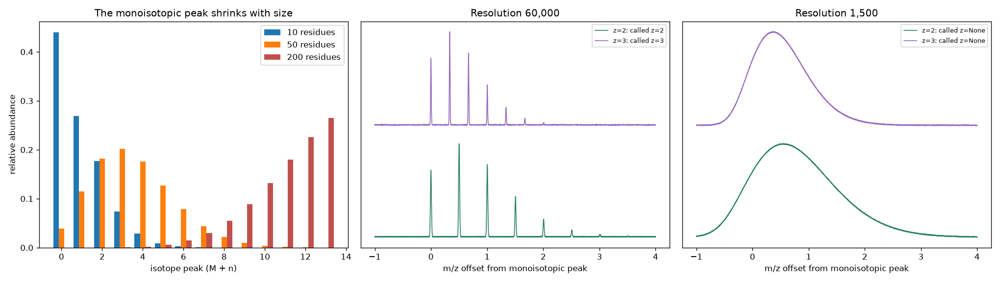

# Mass-Spec Isotope Patterns

> For a 30-residue peptide, the "monoisotopic" peak is barely a tenth of the signal. Pick the wrong isotope and your mass is off by a whole dalton.

## Demo Output



Produced from simulated peptides by `demo.py`: isotope envelopes for small, medium and large peptides, and simulated spectra at high and low resolution with charge states called from peak spacing.

## Why This Exists

Every peptide in a mass spectrum shows up as a family of peaks, one per number of heavy isotopes (mostly carbon-13). That envelope tells you two things search engines rely on: the monoisotopic mass (the all-light-isotope species) and the charge state (from the spacing between peaks, about 1/z). This repo computes envelopes from first principles (residue formulas, natural isotope abundances, convolution) and shows when each step breaks.

## What's Inside

| Function | Purpose |
|----------|---------|
| `composition` / `monoisotopic_mass` | Elemental formula and exact mass from sequence |
| `isotope_envelope` | Relative abundance of M, M+1, M+2... by convolving element patterns |
| `simulate_spectrum` | Gaussian peaks at a given resolution and charge, plus noise |
| `pick_peaks` / `charge_from_spacing` | Centroided peaks and the charge state they imply |

```python
from isotopes import isotope_envelope, monoisotopic_mass, mz
isotope_envelope("PEPTIDEK")
mz(monoisotopic_mass("PEPTIDEK"), charge=2)
```

## Rules of Thumb

| Peptide size | Most abundant peak | Consequence |
|--------------|--------------------|-------------|
| Under about 1,800 Da (around 15 residues) | Monoisotopic | Easy |
| About 2-4 kDa | M+1 or M+2 | Monoisotopic peak still visible, but not the tallest |
| Over about 10 kDa (intact proteins) | M+5 or more | Monoisotopic peak effectively invisible; fit the whole envelope |

## When NOT to Use This

- **Isotope-labelled samples** (SILAC, 15N) shift and distort envelopes. Add the labels to the composition.
- **Post-translational modifications** change the formula. Phosphorylation adds HPO3, for example.
- **Real deisotoping.** Overlapping envelopes from co-eluting peptides need proper deconvolution (for example averagine-based fitting).

## The Uncomfortable Truth

"Off-by-one-dalton" errors, where the M+1 peak is picked as monoisotopic, are a classic source of failed or wrong peptide identifications. Low resolution doesn't just blur peaks. It merges the envelope into a single bump, and the charge state disappears with it.

## Further Reading

- Senko M. W., Beu S. C. & McLafferty F. W. "Determination of monoisotopic masses and ion populations for large biomolecules from resolved isotopic distributions." Journal of the American Society for Mass Spectrometry (1995).
- Valkenborg D. et al. "The isotopic distribution conundrum." Mass Spectrometry Reviews (2012).
- Yergey J. A. "A general approach to calculating isotopic distributions for mass spectrometry." International Journal of Mass Spectrometry and Ion Physics (1983).
